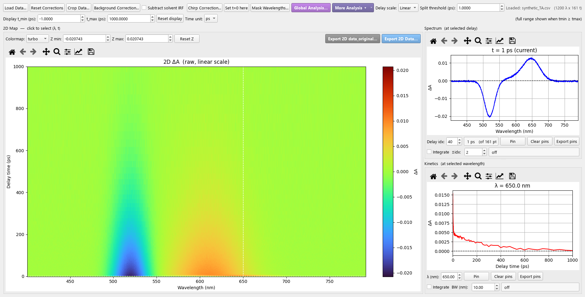
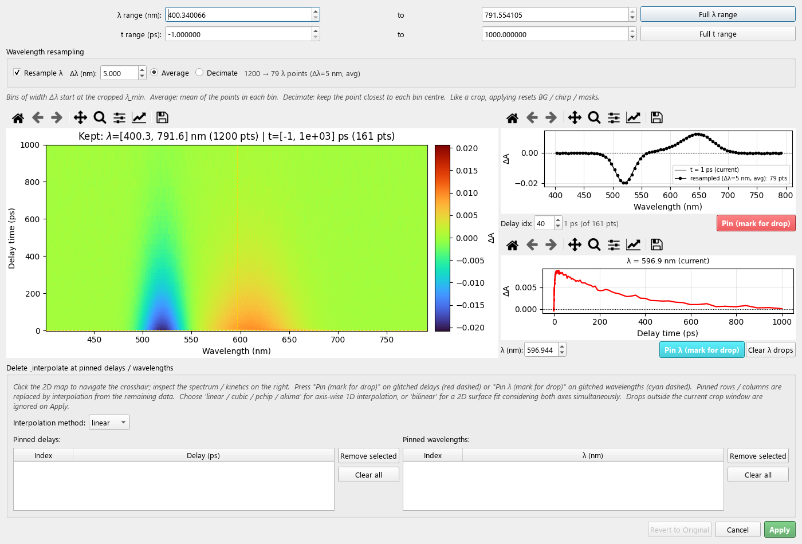
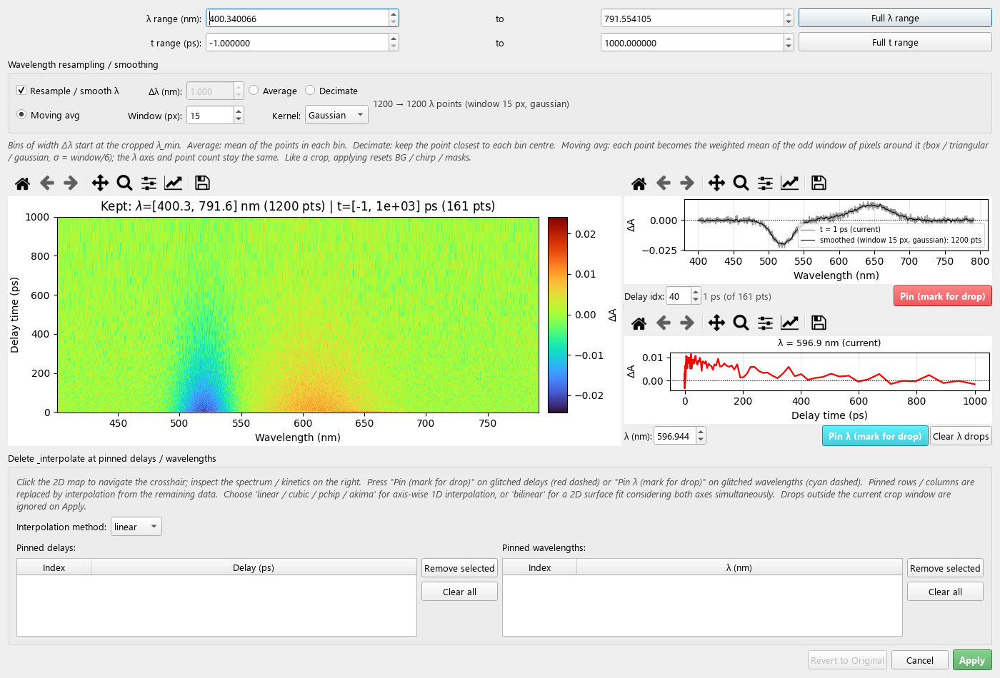
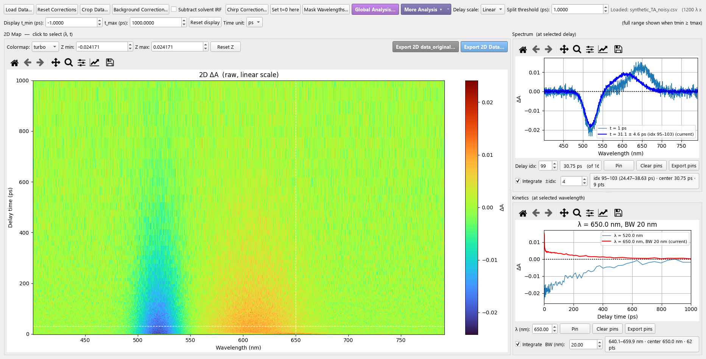
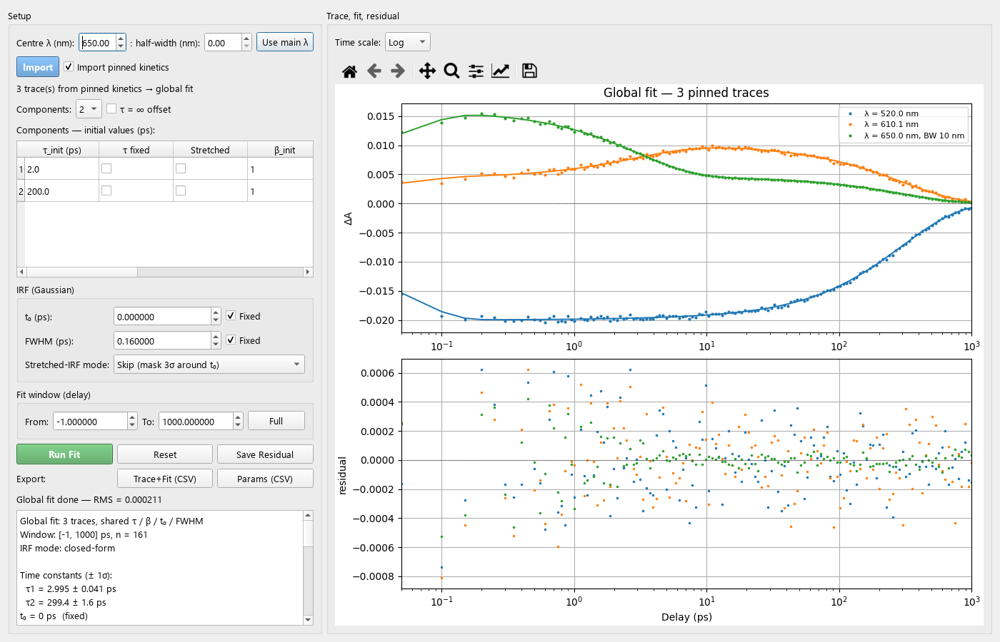
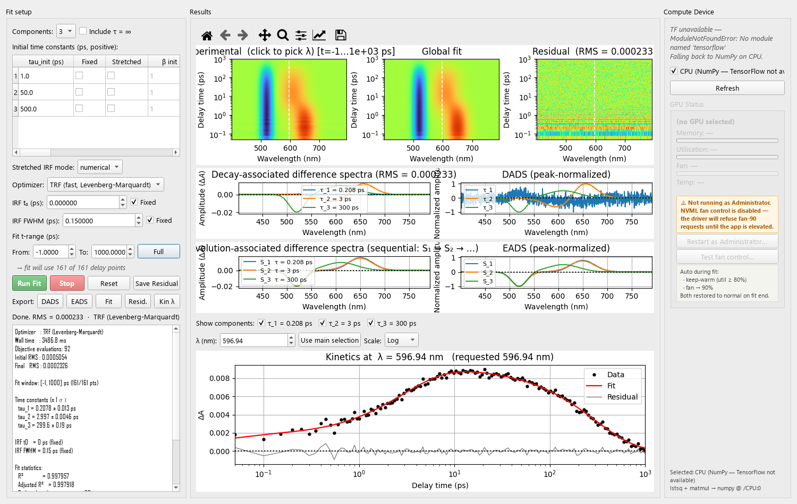
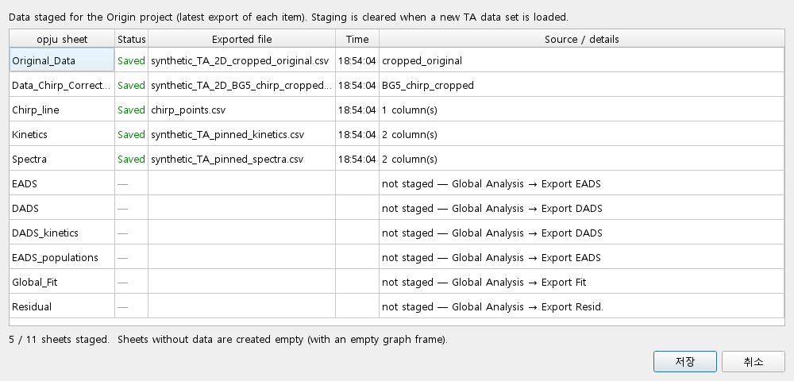

# TA Analyzer — Transient Absorption Data Analyzer

[한국어](README.md) | **English**



## 1. Overview

TA Analyzer is a Windows GUI for loading, correcting, visualizing and analyzing pump-probe transient absorption (TA) data ΔA(λ, t). It is a Python/PyQt5 port of the MATLAB `TRSpecAnalyzer.m`.

Main features:
- **Loading**: auto-detected single files, averaging several files, accumulating repeat scans from a folder, and a Custom loader where you mark the data layout yourself
- **Corrections**: background, chirp (Sellmeier), solvent IRF subtraction, wavelength masks, t=0 shift, crop with **wavelength resampling** (v1.1.0) and **moving-average smoothing** (v1.2.0), and removing/interpolating bad delays or wavelengths
- **Analysis**: Global Analysis (DADS/EADS, stretched exponentials), SVD, single-trace kinetic fit, LDA, MCR-ALS, coherence (FFT map, LPSVD)
- **Export**: 2D matrices (CSV/TSV/xlsx), pinned spectra and kinetics, analysis results and residuals

## 2. Versions and downloads

| Version | Tag | Contents |
|---|---|---|
| **v1.8.0** (latest) | [`v1.8.0`](https://github.com/Myungsam/ta_analyzer/releases/tag/v1.8.0) | Save exported data as an Origin project (.opju) (Export OPJU…, opju dataset info) |
| v1.7.0 | [`v1.7.0`](https://github.com/Myungsam/ta_analyzer/releases/tag/v1.7.0) | Global Analysis Export DADS/EADS saves the spectra and the kinetics/populations separately |
| v1.6.0 | [`v1.6.0`](https://github.com/Myungsam/ta_analyzer/releases/tag/v1.6.0) | Crop window remembers pinned delays/wavelengths; Apply auto-saves Crop_information.csv |
| v1.5.0 | [`v1.5.0`](https://github.com/Myungsam/ta_analyzer/releases/tag/v1.5.0) | Time-domain results (component kinetics, sequential populations) next to DADS / EADS in Global Analysis |
| v1.4.0 | [`v1.4.0`](https://github.com/Myungsam/ta_analyzer/releases/tag/v1.4.0) | Global Analysis σ and fit statistics; Kinetic Fit pin import, global fit and population ratio |
| v1.3.0 | [`v1.3.0`](https://github.com/Myungsam/ta_analyzer/releases/tag/v1.3.0) | Window averaging (Integrate: delay ±idx, wavelength BW) in the Spectrum/Kinetics panels |
| v1.2.0 | [`v1.2.0`](https://github.com/Myungsam/ta_analyzer/releases/tag/v1.2.0) | Moving average in Crop Data (pixel window, Box / Triangular / Gaussian) |
| v1.1.0 | [`v1.1.0`](https://github.com/Myungsam/ta_analyzer/releases/tag/v1.1.0) | Wavelength resampling (Average / Decimate) in Crop Data, Korean/English user guide |
| v1.0.0 | [`v1.0.0`](https://github.com/Myungsam/ta_analyzer/releases/tag/v1.0.0) | Version before resampling |

**Executable (no Python needed)**
Download `TA_Analyzer.exe` for the version you want from the [Releases](https://github.com/Myungsam/ta_analyzer/releases) page and run it.

**Source**
```bash
git clone https://github.com/Myungsam/ta_analyzer.git
cd ta_analyzer
git checkout v1.8.0      # latest (same as main)
git checkout v1.7.0      # before opju export
git checkout v1.6.0      # before DADS/EADS time-data export
git checkout v1.5.0      # before Crop memory / CSV
git checkout v1.4.0      # before the DADS/EADS time panels
git checkout v1.3.0      # before fit statistics / pin import
git checkout v1.2.0      # before Integrate
git checkout v1.1.0      # before moving average
git checkout v1.0.0      # before resampling
```
Without git, use **Source code (zip)** on the Releases page.

## 3. Installation and running

**Executable**: double-click `TA_Analyzer.exe`. It is a single-file executable, so the first start can take a few seconds.

**From Python** (3.10 or newer):
```bash
pip install PyQt5 numpy scipy matplotlib openpyxl comtypes   # comtypes: opju export (section 5.9)
python ta_main.py
```

| Package | Required? | Used for |
|---|---|---|
| PyQt5, numpy, scipy, matplotlib | required | GUI, computation, plots |
| openpyxl | recommended | Excel (.xlsx) export, residual files |
| tensorflow 2.10.x, pynvml | optional | GPU computation and GPU status in Global Analysis |

## 4. Quick start: standard workflow

1. **Load Data...** → choose *Standard* and open a file such as `_TA_spectra_Accumulated.csv`.
2. In **Crop Data...** set the λ/t range and, if needed, turn on **Resample / smooth λ** to reduce the wavelength points (Average/Decimate) or smooth the spectra (Moving avg, section 5.3).
3. **Background Correction...** subtracts the mean of the first N delays (t < 0).
4. **Chirp Correction...**: click the 2D map or use *Auto-place* to mark t₀(λ), then press **Fit & Apply**.
5. (Optional) **Subtract solvent IRF**, **Mask Wavelengths...**
6. **Global Analysis...**: enter the number of components and initial τ values, press **Run**, and inspect DADS/EADS.
7. Save with **Export 2D Data...** and the Export buttons in each analysis window.

Clicking the 2D map updates the Spectrum (selected t) and Kinetics (selected λ) panels on the right. **Pin** keeps several traces overlaid, and the **Integrate** row below averages over a delay/wavelength window (section 5.6).

## 5. Feature guide

### 5.1 Loading data
- **Standard**: auto-detects one file. Selecting several files opens *Load & Average*, which averages the checked files.
- **Custom**: in a table preview, drag to mark the X (wavelength), Y (delay) and Z (ΔA) regions. A transposed matrix is flipped automatically.
- **Accumulation**: preview each repeat scan in a folder (`_TA_spectra_Current_Set_*.csv`, …) as a 2D map and average only the clean ones.

### 5.2 Corrections
Corrections never modify the loaded data; they are recomputed in the order **background → chirp → solvent IRF subtraction → masks**. **Reset Corrections** turns them all off (a loaded solvent file is kept).
- **Background**: subtracts the mean spectrum of the first N delays.
- **Chirp**: points (λ, t₀) are fitted with `t₀(λ) = a·√((bλ²−1)/(cλ²−1)) + d` and every wavelength is shifted in time. Points can be saved to and loaded from CSV.
- **Solvent IRF subtraction**: loads a pure-solvent measurement, aligns it to the sample grid and computes `ΔA − s·ΔA_solvent`. Set the scale `s` with the slider or *Auto*.
- **Mask**: sets wavelength ranges to NaN or 0.
- **Set t=0 here**: moves t=0 to the crosshair position.

### 5.3 Crop, wavelength resampling and moving average



The **Crop Data...** window cuts the λ/t range and can optionally reduce the number of wavelength points (Average / Decimate, v1.1.0) or smooth the spectra while keeping every point (Moving avg, v1.2.0). Only one of the three modes is applied.

1. Enter the `λ range` and `t range` (*Full λ range* / *Full t range* select everything).
2. Check **Resample / smooth λ** and enter the spacing **Δλ (nm)**.
3. Choose **Average** or **Decimate**.
4. Compare the original (grey line) and the result (black dots and line) in the Spectrum panel, and check the point count shown as, e.g., `1200 → 79 λ points`.
5. Press **Apply**.

**How it works**
- The axis is split into bins of width Δλ starting at the first wavelength λ_min of the cropped range: `[λ_min + kΔλ, λ_min + (k+1)Δλ)`. A point exactly on a boundary goes into the upper bin.
- **Average**: the wavelength and ΔA of all points in a bin are averaged (NaNs are ignored; an all-NaN bin stays NaN). This lowers the noise.
- **Decimate**: only the original point closest to each bin centre is kept; the others are dropped. The values are real measured values, not averages.
- Bins that contain no original point (e.g. masked regions or gaps) are left out.
- Measured wavelength spacing is usually not uniform (e.g. 0.27–0.38 nm), so the resulting wavelengths are only approximately Δλ apart.

**Notes**
- Like a crop, Apply **resets background, chirp, masks, the t=0 shift and Global Analysis results**. Resample first, then apply corrections.
- If Δλ is not larger than the mean wavelength spacing, a warning appears and **only the crop is applied, without resampling**.
- With solvent IRF subtraction, the solvent is reduced with **exactly the same bins** as the sample before it is subtracted.
- With resampling on, pin interpolation rebuilds from the original and re-applies the whole remembered pin list (since v1.6.0 the list is kept, so earlier interpolations are not lost).
- **Revert to Original**, or Full range + unchecked Resample + Apply, returns to the original resolution. The status bar shows the state, e.g. `[resampled Δλ=5 nm, avg]`, and exported file names get `rs5nm` appended.

#### Moving average (v1.2.0)



1. Check **Resample / smooth λ** and choose **Moving avg** (the Δλ field is disabled; Window and Kernel become active).
2. Enter the window size k in **Window (px)**. Only odd values **3–101** are allowed; the default is 5.
3. Choose the **Kernel**:
   - **Box**: every point in the window has the same weight
   - **Triangular**: weights 1, 2, …, m, …, 2, 1 (m = (k+1)/2), largest in the centre
   - **Gaussian**: weights exp(−x²/2σ²) with **σ = k/6** (the window covers ±3σ)
4. Compare the original (grey) and the smoothed result (black line) in the Spectrum panel, check that the point count is unchanged, e.g. `1200 → 1200 λ points (window 15 px, gaussian)`, and press **Apply**.

**How it works**
- Each wavelength point i gets the weighted mean of the k pixels centred on it: ΔA′ᵢ = Σ wⱼ ΔAᵢ₊ⱼ / Σ wⱼ. Every delay is smoothed the same way.
- The **wavelength axis is unchanged** and so is the number of points. The window is in pixels, not nm, so with non-uniform spacing its width in nm varies slightly along the spectrum.
- At the **edges** (first and last k//2 points) the positions outside the range are left out and the remaining weights renormalised, so edge values lean slightly towards their inner neighbours.
- **NaN** points in a window (e.g. masks) are left out and the weights renormalised; a window that is entirely NaN gives NaN.
- With solvent IRF subtraction, the solvent is smoothed with **the same kernel** before it is subtracted.
- If the window is even, outside 3–101, or not smaller than the number of points in the selected range, a warning appears and **only the crop is applied, without smoothing**.
- As with Average/Decimate, Apply resets the corrections and Revert restores the original. The status bar shows e.g. `[smoothed 15 px, gaussian]` and exported file names get `_ma15gaussian`.

**Removing and interpolating delays/wavelengths**: mark glitched delays or wavelengths with **Pin (mark for drop)**; they are refilled with linear/cubic/pchip/akima/bilinear interpolation.

**Remembered settings and Crop_information.csv (v1.6.0)**
- The **Pinned delays / Pinned wavelengths** lists and the interpolation method stay when the Crop window is closed and reopened. They are cleared **only when new data is loaded** (not by Revert to Original).
- Applying after removing an already-applied pin, or after changing the method, rebuilds from the original so the removed pin's interpolation does not stay in the data (corrections are reset in that case, too).
- Every **Apply** writes **`Crop_information.csv`** into the folder of the loaded data file (overwritten each time). The status bar then ends with `· saved Crop_information.csv`; hovering shows the full path.
- Contents (`parameter,value,unit,index`): source file, time saved, λ/t range, original and result point counts, whether Resample/smooth was on and its mode (Δλ, or window and kernel), whether it was actually applied (`False` when Apply fell back to a plain crop), interpolation method, and every pinned delay/wavelength with its original-grid index
- Data that did not come from a folder (e.g. synthetic data) is not saved.

```
parameter,value,unit,index
wavelength_min,450,nm,
resample_mode,moving,,
moving_window,7,px,
pinned_delay_1,9.63291,ps,40
pinned_wavelength_1,520,nm,60
```

### 5.4 Analysis
| Menu | Description |
|---|---|
| **Global Analysis** | Fits a sum of exponentials ⊗ Gaussian IRF to the whole matrix (fixed τ, stretched β, τ=∞ component, fit window). Results: τ ± σ, DADS and EADS with their time-domain results (section 5.8), fit, residual, fit statistics (section 5.7). GPU selectable when TensorFlow is installed |
| **SVD** | Singular value spectrum, U/V vectors, rank-N reconstruction and residual |
| **Kinetic Fit** | Fits one wavelength (or a wavelength-window average), or several kinetics pinned in the main window, with multi-exp ⊗ IRF (global fit for several). τ and A ± σ, population ratio, fit statistics (section 5.7) |
| **LDA** | Tikhonov-regularized lifetime density map, L-curve for choosing α |
| **MCR-ALS** | Decomposes into pure spectra S(λ) and concentration profiles C(t) |
| **Coherence** | 2D \|FFT\|² map of the residual (cm⁻¹/THz), LPSVD mode decomposition |

**Save residual** in GA and LDA writes an xlsx to the `residuals/` folder, which the Coherence window can load again.

### 5.5 Export
- **Export 2D Data...**: the corrected matrix. The file name records the state (e.g. `_2D_BG5_chirp_cropped_rs2nm.csv`, or `_ma5box` for a moving average).
- **Export 2D data_original...**: the matrix before corrections (crop/resampling included)
- **Export pins** in the Spectrum/Kinetics panels and the Export buttons in each analysis window. Pins taken with Integrate export the window mean, with the window in the header (`dA_t=30.75ps_avg_idx95-103`, `dA_wl=650nm_BW20nm`).

### 5.6 Spectrum / Kinetics window averaging (Integrate, v1.3.0)



Checking **Integrate** on the row below the Spectrum or Kinetics panel draws the mean over a window (NaN ignored) instead of a single trace.

| Panel | Input | Averaged window | Legend example |
|---|---|---|---|
| Spectrum | **±idx** (N) | delay indices `idx−N … idx+N` (2N+1 points, clipped at the array ends) | `t = 31.1 ± 4.6 ps (idx 95–103)` — mean ± std of the window delays |
| Kinetics | **BW (nm)** | pixels with `|λ − λc| ≤ BW/2` around the selected λc | `λ = 650.0 nm, BW 20 nm` |

- The indicator box on the right shows the window actually averaged, its center and the point count (e.g. `idx 95–103 (24.47–38.63 ps) · center 30.75 ps · 9 pts`, `640.1–659.9 nm · center 650.0 nm · 62 pts`); `off` when unchecked.
- **Pin** while checked stores the window with that pin; pinning while unchecked gives a single trace as before. Re-pinning the same delay/λ replaces its window.
- ±idx = 0, or a BW narrower than the pixel spacing, equals a single trace. The data itself is not changed; only the display and Export pins use the window.

### 5.7 Fit statistics and Kinetic Fit import (v1.4.0)



The **Global Analysis result pane** now shows:
- The standard deviation of each time constant: `tau_1 = 2.997 ± 0.0046 ps`. β, IRF t₀ and FWHM also get ± σ when free; fixed values are marked `(fixed)`.
- A **Fit statistics** block: R², adjusted R², reduced χ², RSS, RMS residual, AIC / BIC, number of points, parameters and degrees of freedom

σ is the asymptotic 1σ standard error from the covariance matrix built from the Jacobian at the optimum. The amplitudes (DADS) are re-solved for every τ, so the τ errors already include the amplitude uncertainty. A σ larger than τ itself means the data do not determine that component (use fewer components).

**Kinetic Fit window** (More Analysis → Kinetic Fit)
- Data enter only when **Import** is pressed. The window opens empty; after changing λ / half-width or the main-window pins, press Import again.
- **Import pinned kinetics** checkbox (checked on opening when the main window has pinned kinetics)
  - Checked: import every trace pinned in the main Kinetics panel. Pins taken with Integrate BW keep their band average.
  - Unchecked, or no pins: import a single Centre λ ± half-width trace as before.
- Two or more traces are fitted **globally** (τ, β, t₀ and FWHM shared, amplitudes per trace); a single trace gets a **single fit**.
- Results: τ ± σ, A ± σ for each trace with its **population ratio** `|Aᵢ| / Σ|Aⱼ| × 100 %` (including A∞ when the τ=∞ offset is on), R² per trace, and the same fit statistics block
- Export: Params (CSV) includes σ, ratios and statistics (`T1_`, `T2_` … prefixes for a global fit); Trace+Fit writes data/fit/residual columns per trace; Save Residual writes one `kfit_{λ}nm_<name>.csv` file per trace (the Coherence window recognises the λ).



### 5.8 DADS / EADS time-domain results (v1.5.0)

The DADS and EADS rows of the Global Analysis results now end with a delay-axis plot.

| Row | Left → right | Time plot |
|---|---|---|
| DADS | DADS · DADS (normalized) · **DADS kinetics C(t)** | Parallel-model kinetics of each component, `C_j(t) = exp(−t/τ_j) ⊗ IRF` (β for stretched components, a step for τ=∞), unit amplitude |
| EADS | EADS · EADS (normalized) · **EADS populations c(t)** | Species populations of the sequential model S₁ → S₂ → …. Since `DADS·C(t)ᵀ = EADS·c(t)ᵀ`, both rows split the same fit in two ways |

- Curves use the fitted t₀, FWHM, τ and β on a dense grid over the fit window (denser over the IRF rise) that also contains the measured delays.
- The x axis follows the **Scale** (Log/Linear) selector of the kinetics plot below, and **Show components** hides curves in the time plots too.
- The **Export: DADS / EADS** buttons save two files (v1.7.0), always with every component, including hidden ones.

| Button | Spectra file | Time file |
|---|---|---|
| DADS | `DADS_spectra.csv` (`wavelength_nm`, `DADS_tau=…`) | `DADS_kinetics.csv` (`delay_ps`, `C_tau=…`) |
| EADS | `EADS_spectra.csv` (`wavelength_nm`, `EADS_S1_tau=…`) | `EADS_populations.csv` (`delay_ps`, `pop_S1_tau=…`) |

  The time files use the plotted grid (measured delays + fill points + IRF rise). Renaming the file in the save dialog renames its companion too (e.g. `sample_DADS_spectra.csv` → `sample_DADS_kinetics.csv`). If only the companion already exists, you are asked before it is overwritten.

### 5.9 Export to an Origin project (.opju) (v1.8.0)



Saving a CSV with one of the exports below also **stages** the same data for the opju; only the latest export of each item is kept.

| opju sheet | Staged by |
|---|---|
| Original_Data | **Export 2D data_original...** |
| Data_Chirp_Corrected | **Export 2D Data...** — only while chirp correction is applied |
| Chirp_line | Chirp Correction window **Save points** |
| Kinetics / Spectra | Kinetics / Spectrum panel **Export pins** |
| EADS + EADS_populations / DADS + DADS_kinetics | Global Analysis **Export EADS / DADS** |
| Global_Fit / Residual | Global Analysis **Export Fit / Resid.** |

1. Export the CSVs you need, then press **Export OPJU...** above the main 2D map.
2. The **opju dataset info** window lists each sheet's status (Saved / —), the exported file, time and details.
3. **저장** (Save) asks for the location (default: `Transient absorption_filled.opju` in the data folder) and runs `add_function/ta_opju_builder.py`, which builds 11 sheets and 9 graphs in Origin; progress is shown at the bottom. **취소** (Cancel) only closes the window and keeps the staging.
4. The staged data is cleared **when a new TA data set is loaded** (and when the program exits).

- Needs **Origin 2018 or later**; running from Python also needs `comtypes` (`pip install comtypes`; bundled in the exe). Saving is refused while Origin is running — close all Origin windows first.
- Sheets without data are created empty with an empty graph frame. Exports saved as .xlsx/.tsv put the same values into the opju.

## 6. Input file formats

CSV / TSV / DAT / TXT are read automatically (delimiter detection, blanks and NaN handled).

**Format A** (first row = delays, first column = wavelengths)
```
corner, t1, t2, ..., tN
λ1,     ΔA, ΔA, ..., ΔA
λ2,     ΔA, ...
```
**Format B** (two metadata columns: `row[0][2:]` = delays, `row[i][1]` = wavelength)

For files that match neither, use **Load Data → Custom** and mark the regions yourself. Exported 2D files use Format A, so they can be loaded again.

## 7. Troubleshooting

| Symptom | Fix |
|---|---|
| The exe starts slowly or antivirus blocks it | The single-file exe unpacks itself on first start. Add an antivirus exception |
| A file cannot be read | Use the Custom loader and mark the X/Y/Z regions |
| BG/chirp disappeared after resampling | Expected (section 5.3). Apply the corrections again after resampling |
| "Δλ must be larger..." warning | Enter a Δλ larger than the mean wavelength spacing |
| "moving-average window must be odd..." warning | Use an odd window (3–101) smaller than the number of points in the selected range |
| Global Analysis does not converge | Change the initial τ values or fix the IRF t₀/FWHM |
| Restore a zoomed plot | Toolbar Home button, or right-click the panel → Auto scale |

## 8. Developer information

- Architecture: [ARCHITECTURE.md](ARCHITECTURE.md) (Korean) · detailed manuals: [`manual/`](manual/) (Korean/English, md and pdf)
- Tests: run each `test/test_*.py` directly (no pytest needed).
  ```bash
  # Git Bash, from the project root
  export PYTHONPATH=. PYTHONIOENCODING=utf-8 QT_QPA_PLATFORM=offscreen
  python test/test_crop_resample.py
  python test/test_crop_moving_average.py
  python test/test_pin_gating.py
  python test/test_fit_stats_kfit_import.py
  python test/test_ga_time_panels.py
  python test/test_crop_memory_info.py
  python test/test_opju_export.py
  ```
  Four tests with hard-coded measurement-data paths (`test_real_file`, `test_session_fixes`, `test_crop_input_fix`, `test_crop_preview_perf`) cannot run without that data. The zoom check in `test_new_features` is a known failure since v1.0.0.
- Build: `python -m PyInstaller ta_analyzer.spec --noconfirm --clean` → `dist/TA_Analyzer.exe`
- Regenerate the README images: `python tools/make_screenshots.py` (synthetic data; `--scenes main,crop,moving,gating,kfit,ga,opju` selects a subset)
- Measurement data (`Data/`), test data folders and build outputs are not part of the repository.

## 9. Changelog

**v1.8.0** (2026-10-28)
- **Export OPJU...** button and **opju dataset info** window: review the data staged by the exports (2D original / chirp-corrected, chirp points, pins, DADS/EADS + kinetics/populations, GA fit/residual); **저장** builds the .opju with `add_function/ta_opju_builder.py`
- Staging keeps the latest export per item and is cleared when new data is loaded
- `add_function/` now carries the builder's dependencies (`ta_opju_filler.py`, `origin_templates/*.otpu`); the exe bundles comtypes and the templates

**v1.7.0** (2026-10-27)
- Global Analysis Export **DADS**: `DADS_spectra.csv` + `DADS_kinetics.csv` (component kinetics C(t)); **EADS**: `EADS_spectra.csv` + `EADS_populations.csv` (sequential populations)

**v1.6.0** (2026-10-27)
- Crop window: pinned delays / wavelengths and the interpolation method are remembered (reset only when new data is loaded)
- Crop window: Apply auto-saves `Crop_information.csv` in the data folder (λ/t range, resample / moving-average settings, method, pins with index)
- Removing an applied pin or changing the method rebuilds from the original, so the old interpolation does not remain

**v1.5.0** (2026-10-27)
- Global Analysis: component kinetics C(t) ⊗ IRF next to DADS and sequential populations c(t) next to EADS (linked to Scale and Show components)
- Shorter DADS/EADS titles for the three-column layout

**v1.4.0** (2026-10-27)
- Global Analysis: 1σ standard deviations of τ, β, t₀ and FWHM, plus fit statistics (R², adjusted R², reduced χ², RSS, RMS, AIC/BIC, degrees of freedom)
- Kinetic Fit: **Import** button and **Import pinned kinetics** checkbox; pinned kinetics are fitted globally (shared τ), a single trace gets a single fit
- Kinetic Fit: τ and A ± σ, population ratio |Aᵢ|/Σ|Aⱼ| (%), R² per trace, fit statistics; exports include σ, ratios and statistics
- Kinetic Fit data enter only on Import (editing λ no longer redraws automatically)

**v1.3.0** (2026-10-27)
- Spectrum panel **Integrate ±idx**: spectrum averaged over a delay-index window; legend shows the window delays' mean ± std
- Kinetics panel **Integrate BW (nm)**: kinetics averaged over λc ± BW/2
- New row under each panel with checkbox, input and an indicator (window, center, point count)
- Pins remember their window; Export pins writes the window mean and tags the header with the window
- Fixed the Kinetics title keeping the previous wavelength while pins exist

**v1.2.0** (2026-09-28)
- **Moving avg** mode in Crop Data: pixel window (odd, 3–101), Box / Triangular / Gaussian (σ = k/6) kernels
- Wavelength axis and point count unchanged; edges and NaNs renormalised
- Solvent IRF smoothed with the same kernel; status bar `[smoothed k px, kernel]`, file names `_ma{k}{kernel}`
- Crop window group renamed "Wavelength resampling / smoothing"

**v1.1.0** (2026-09-28)
- Wavelength resampling in Crop Data: Δλ (nm), Average (bin mean) / Decimate (point closest to the bin centre)
- Resampling preview and point count in the Crop window's Spectrum panel
- Solvent IRF subtraction uses the same bins as the sample
- Fixed the outermost wavelength being cut off by spinbox rounding
- Korean/English user guide (README.md, README_EN.md) with screenshots

**v1.0.0**
- Baseline before resampling: three loaders, BG/chirp/solvent IRF/mask corrections, crop with interpolation, Global Analysis, SVD, kinetic fit, LDA, MCR-ALS, coherence
